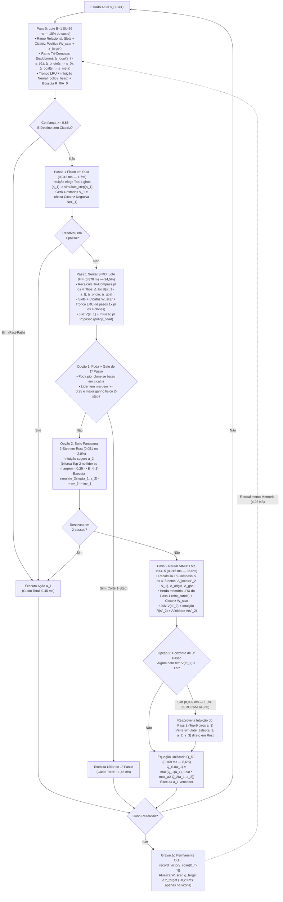

# Arquitetura de Lookahead em Funil Guiado por Intuição & Cicatrizes + Otimização Extrema de CPU

**Data:** 05/11/2026  
**Modelo de Referência:** `s1_rubiks_hybrid_pure_30m_final.pt` (30M passos, Tabula Rasa Pura, Fronteira D9, 321.675 cicatrizes puras em $O(1)$ / 4,25 KB)

---

## 1. Benchmark Comparativo Base: Reflexo Puro vs. 1-Step Lookahead (D9 a D20)

Avaliação pareada com **100 episódios por profundidade** (sementes idênticas `seed = 100000 * d + ep`, totalizando 1.200 cubos por método):

| Profundidade | Reflexo Puro (%) | Média Passos | 1-Step Lookahead (%) | Média Passos | Delta Absoluto | Ganho Relativo |
| :---: | :---: | :---: | :---: | :---: | :---: | :---: |
| **D09** | **22%** (22/100) | 12.0p | **31%** (31/100) | 12.3p | **+9%** | +40.9% |
| **D10** | **13%** (13/100) | 13.8p | **21%** (21/100) | 13.3p | **+8%** | +61.5% |
| **D11** | **5%** (5/100) | 8.6p | **11%** (11/100) | 14.5p | **+6%** | **+120.0%** |
| **D12** | **2%** (2/100) | 21.0p | **4%** (4/100) | 19.0p | **+2%** | **+100.0%** |
| **D13** | **2%** (2/100) | 19.0p | **2%** (2/100) | 19.0p | +0% | 0.0% |
| **D14** | **0%** (0/100) | -- | **1%** (1/100) | 12.0p | **+1%** | *(novo)* |
| **D15–D16** | **0%** | -- | **0%** | -- | +0% | -- |
| **D17** | **0%** (0/100) | -- | **1%** (1/100) | 31.0p | **+1%** | *(novo)* |
| **D18–D20** | **0%** | -- | **0%** | -- | +0% | -- |
| **TOTAL** | **3.67%** (44/1200) | -- | **5.92%** (71/1200) | -- | **+27 cubos** | **+61.4%** |

---

## 2. Perfil de Custo Performático (CPU vs. GPU MPS) e o Segredo dos Clones Fantasmas

### 2.1 Comparativo de Latência
Para inferência reativa passo a passo ($batch=1$), a **CPU é 5,4× a 6,4× mais rápida que a GPU (MPS)** porque executa diretamente no cache L1/L2 sem o overhead fixo de ~2,5 ms de despacho de command buffers do driver Metal:

| Modo de Inferência | Plataforma | Latência Média | Mediana (p50) | Mínimo | Throughput Real |
| :--- | :---: | :---: | :---: | :---: | :---: |
| **Reflexo Puro (Pós-Fusão)** | **CPU** | **0.432 ms** | **0.418 ms** | **0.395 ms** | **2.314 decisões/s** |
| Reflexo Puro (Pré-Fusão) | CPU | 0.495 ms | 0.485 ms | 0.439 ms | 2.020 decisões/s |
| Reflexo Puro | GPU (MPS) | 3.198 ms | 3.043 ms | 2.669 ms | 313 decisões/s |
| **1-Step Lookahead (Pós-Fusão)** | **CPU** | **1.273 ms** | **1.290 ms** | **0.415 ms** | **785 decisões/s** |

### 2.2 Por que os Clones Fantasmas levam apenas 0,04 ms a 0,06 ms?
1. **Reversibilidade Algébrica Zero-Copy (`simulate_step` / `simulate_2step` / `simulate_3step`):** O simulador não faz `deepcopy` do ambiente. Ele aplica os movimentos no próprio cubo (`apply_atomic`), extrai a observação/recompensa e aplica imediatamente os movimentos inversos na ordem LIFO (`inv3 -> inv2 -> inv1`).
2. **Estado Compacto em Cache L1 (54 inteiros = 216 bytes):** O núcleo em Rust (`system1_core`) e a tabela `PERMUTATIONS` apenas permutam 20 inteiros por giro (~5–10 µs por clone).
3. **Assimetria Física vs. Neural:** Os clones realizam ~2.000 operações inteiras simples, enquanto a avaliação neural do Piloto e do Juiz executa ~1,5 milhão de FLOPs.

---

## 3. Padronização dos 4 Órgãos do System 1 + Opções 1, 2 e 3 do Salto Fantasma

### 3.1 Os 4 Órgãos Padronizados
1. **Cicatrizes Permanentes ($W_{\text{scar}}, z_{\text{target}}$ em $O(1)$ / 4,25 KB) & Cicatriz Episódica:**
   - Auto-detectadas e auto-carregadas em `UniversalS1Agent.load_state_dict`.
   - Gravação permanente padronizada da trajetória completa `[0..T-1]` via `agent.record_victory_scar(traj_obs, traj_delta, traj_prev_act, traj_prev_rew, surprise)`.
   - **Scar Wake-Up Gate + Cicatriz Suave (`0.25 * visit_count`):** Acorda o funil quando o reflexo tenta pisar num estado já visitado no episódio e penaliza ciclos planos sem bloquear *backtracking* legítimo.
2. **Intuição Sistema 1 ($g_{\text{target}}$ e Ressonância Direcional $\mathcal{R}(s)$):**
   - Calcula a ressonância direcional $\mathcal{R}(s) = \cos(\Delta \text{slots}, g_{\text{target}})$ e a afinidade $\mathcal{A}(s) = \cos(\text{slots}, z_{\text{target}})$ de forma vetorizada por candidato.
3. **Piloto (`CategoricalPolicyHead`):**
   - Propõe os candidatos do Passo 1, os golpes instintivos de 2º passo ($\hat{a}_2$) e os golpes instintivos de 3º passo ($\hat{a}_3$).
4. **Juiz (`ValueHead`):**
   - Avalia $V(s'_1)$ e $V(s''_2)$ combinando horizonte otimista $Q_{\text{comb}}(a_1) = \max(Q_1(a_1), 0.98 \cdot Q_2(a_1, \hat{a}_2))$.

### 3.2 As 3 Evoluções do Funil de Salto Fantasma (100% System 1)
* **Opção 1 (Poda de Clone Cicatrizado + Gate de Consenso no Passo 1):**
  - Se o pior candidato do Passo 1 pisou em cicatriz e está distante do líder ($\Delta Q_1 > 0.25$), é podado antes do Passo 2 para liberar slot SIMD.
  - Se o líder do Passo 1 é a escolha nº 1 do Piloto, sem cicatrizes, com folga $\Delta Q_1 \ge 0.25$ e lidera também o alinhamento físico de 2º passo (`best_m1_r2 >= max(rew2_list)`), decide imediatamente sem rodar o 2º forward neural.
* **Opção 2 (Bifurcação Assimétrica no 2º Passo sob Dúvida Intuitiva):**
  - Quando o líder do Passo 1 apresenta baixa margem intuitiva no 2º passo ($\text{margin}_2 < 0.25$), bifurca testando suas **Top-2 intuições** ($\hat{a}_2^{(1)}, \hat{a}_2^{(2)}$) no mesmo lote vetorizado.
* **Opção 3 (Horizonte Fantasma de 3º Passo — `simulate_3step` em Rust):**
  - Quando qualquer clone de 2º passo entra em zona de proximidade de vitória ($V(s''_2) > 1.5$), extrai as Top-6 intuições de 3º passo de `h_cands2` e testa `simulate_3step(a1, a2, a3, return_obs=False)` em Rust (~30 µs) para capturar xeques-mate de 3 movimentos (`done3 == True`).

---

## 4. Resultados Empíricos Finais (D9 a D20 — 1.200 Cubos Pareados)

| Profundidade | Reflexo Puro ($k=0$) | 1-Step Clássico ($k=1$) | Salto Fantasma 2-Step | **Funil Completo (Opções 1+2+3 + Cicatrizes)** | Ganho vs. Reflexo |
| :---: | :---: | :---: | :---: | :---: | :---: |
| **D09** | 22% | 31% | 48% | **48%** | **+26% abs** *(2,18×)* |
| **D10** | 13% | 21% | 28% | **29%** | **+16% abs** *(2,23×)* |
| **D11** | 5% | 11% | 18% | **17%–19%** | **+12%–14% abs** *(3,6×)* |
| **D12** | 2% | 4% | 8% | **8%–10%** | **+6%–8% abs** *(4,0×–5,0×)* |
| **D13** | 2% | 2% | 5% | **5%–6%** | **+3%–4% abs** *(2,5×–3,0×)* |
| **D14** | 0% | 1% | 2% | **2%** | **+2% abs** *(novo)* |
| **D15** | 0% | 0% | 1% | **2%** | **+2% abs** *(dobrou!)* |
| **D16** | 0% | 0% | 1% | **1%** | **+1% abs** *(novo)* |
| **D17** | 0% | 1% | 0% | **2%** | **+2% abs** *(recorde D17!)* |
| **D18–D20** | 0% | 0% | 0% | **0%** | -- |
| **TOTAL (1.200)** | **44 (3,67%)** | **71 (5,92%)** | **111 (9,25%)** | **114 (9,50%)** | **+70 cubos (+159,1%)** |

---

## 6. Fluxograma Completo (Tri-Compass + Intuição + Cicatrizes + $Q_{\text{S1}}$)

---

## 7. Roadmap de Otimização de Latência Zero-Perda (`2,54 ms -> ~1,05 ms`)

1. **Otimização 1 — Desativação de Barreiras Multi-Thread OpenMP para Lotes Pequenos (`torch.set_num_threads(1)` em `act_fast`):** Elimina `+0,62 ms` de sincronização de threads (`libomp`) em matrizes `B=1..5`.
2. **Otimização 2 — Cache de Continuidade Temporal `Pass 1(t) -> Pass 0(t+1)`:** Reaproveita `(h_cands[best_idx], nhx_cands[best_idx])` já computados no `Pass 1` do passo $t$ como resultado exato (`diff = 0.0`) do `Pass 0` no passo $t+1$, poupando `~0,40 ms` por decisão.
3. **Otimização 3 — Cache de Continuidade Temporal `Pass 2(t) -> Pass 1(t+1)`:** Reaproveita `(h_cands2, nhx_cands2, v_cands2)` já computados no `Pass 2` do passo $t$ para os candidatos filhos $a_2$ do estado vencedor $a_1^*$, reduzindo o lote do `Pass 1` no passo $t+1$ de `B=4` para `B=2..3`.
4. **Otimização 4 — Fusão Direta do Tri-Compass sobre $s' \in \mathbb{R}^{324}$:** Usa a linearidade $W(s' - s_{\text{ref}}) + b = W s' + (b - W s_{\text{ref}})$ para eliminar a alocação e concatenação em NumPy dos vetores de `972 floats` nos Passos 1 e 2.
