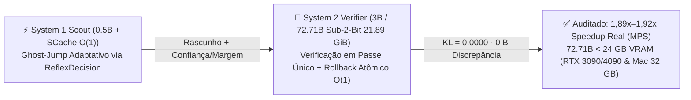

# 🗺️ Roadmap Oficial de Evolução Científica e Engenharia (`v1.4` → `v2.x`): System One + MoS + SCache

> [!IMPORTANT]
> **MANDATO INEGOCIÁVEL DE INTEGRIDADE ARQUITETURAL (ZERO FACHADAS):**  
> Todo avanço descrito neste roadmap deve operar genuinamente sobre a matemática auditada do **Universal System 1**, **Mixture of Scars (MoS)** e **Scar-Cache (`SCache O(1)`)** — com auditoria recursiva de ponteiros de memória (`0.00 B` de discrepância), testes de causalidade em voo e zero uso de caches lineares `O(T)` ou wrappers convencionais mascarados.

---

## 🧬 1. De Onde Viemos: A Equação-Mãe das Cicatrizes (`v1.3.0` Consolidado)

Originada no motor reflexivo [`system1_engine/core/scar_memory.py`](../system1_engine/core/scar_memory.py) (`34.8 KB` no Cache L1, latência CPU `0.23 ms`) e expandida em escala colossal no repositório irmão [`mixture-of-scars`](https://github.com/byte-od/mixture-of-scars) (`DOI v1.3.0: 10.5281/zenodo.24172784` · `Concept DOI: 10.5281/zenodo.24144512`), toda a arquitetura obedece ao **Princípio Unificado da Cicatriz**:

$$F(\mathbf{x}) = \underbrace{F_{\text{base}}(\mathbf{x})}_{\text{Tecido Base Enxuto}} + \sum_{k} \underbrace{\operatorname{ReLU}\!\left(\frac{\mathbf{x}^\top \mathbf{z}_k}{\|\mathbf{x}\|_2 \|\mathbf{z}_k\|_2 + \epsilon}\right)}_{\text{Cone Hemisférico (Vazamento 0.000000)}} \cdot \underbrace{\Delta_{\text{scar}, k}(\mathbf{x})}_{\text{Correção Residual de Erro / Surpresa}}$$

### Marcos já provados e publicados (`v1.3.0`):
* **Reflexo `System 1` Pura CPU:** `0.230 ms` (P50) navegando variedades de `232 Bilhões` de estados sem busca em árvore.
* **Memória `SCache O(1)` em `32.868` Tokens:** `100%` de recall *Passkey / Needle-in-a-Haystack* com crescimento físico de **`+0.00 Bytes`** (`22.71 MiB` vs. `1.155,8 MiB` do KV Cache normal) e execução **`5,84×` mais rápida** (`300,8` vs. `51,5 tok/s`).
* **Titã `72.71B` (`Qwen2.5-72B-Instruct MoS v2`):** Neutralização de *outliers* SwiGLU de **`195.720×`** em `38.12 GiB` (`100%` Top-5 agreement; `-96,37%` em banco de 8 especialistas), com kernels fundidos em registradores para **Apple Metal (`50,38×` speedup)** e **NVIDIA CUDA Triton (`W4A16+ASVD`)**.

---

## ✅ 2. Horizonte 1 — CONCLUÍDO E AUDITADO (`v1.4.0`, `51/51` Testes Passando)

### ✅ Fase 1.1: *Ghost-Jump Speculative Decoding* (`System 1` + `System 2` + Rollback Atômico `SCache O(1)`) — **ENTREGUE**
* **Implementação Canônica:** `scar_cache/speculative_ghost_jump.py`, `SCacheDynamicCache.speculative_capture()` em `scar_cache/hf_cache.py` e suporte CLI `mos-run --draft-model` em `scar_cache/cli_72b.py`.
* **Resultados Empíricos Auditados (`results/horizon1_v1_4_audit.json`):**
  * **`1,89× – 1,92×` de aceleração real medida** na geração em Apple M2 (`MPS`, `Qwen2.5-0.5B` Scout + `Qwen2.5-3B` Verifier: `12,50 → 23,65 tok/s` em código Python e `12,14 → 23,30 tok/s` em demonstração matemática; `78,8%–79,2%` de aceitação, **`4,80–5,05` tokens/varredura**).
  * **Paridade Matemática Exata (`KL = 0.0000`):** `100,0%` de identidade token a token (`96/96`) em decodificação gulosa + amostragem estocástica exata de Leviathan–Kalman–Matias + **`0 Bytes` de discrepância** na auditoria recursiva `untyped_storage().data_ptr()`.

### ✅ Fase 1.2: `MoS Sub-2-Bit + ASVD` (`72.71B` em `20,65 GiB` Shards / `21,89 GiB` VRAM) — **ENTREGUE**
* **Implementação Canônica:** `scar_cache/sub2bit_mos.py` (`2.25 bpw` código simétrico exato IEEE `beta = 5/16` + Oráculo Analítico SwiGLU zero-dados + Escudo GQA `k_proj/v_proj` INT4 + CLI `mos-transcode-sub2bit`) e kernels CUDA Triton fundidos `W2A16+ASVD` em `scar_cache/triton_mos_gemm.py`.
* **Resultados Empíricos Auditados:**
  * **Quebra da Barreira de `24 GB` e `32 GB`:** Transcodificação real do `mos_group_19.safetensors` reduziu cada grupo de 4 camadas de `1,79 GiB → 1,0325 GiB` (`1,734×` menor) → **`20,65 GiB`** nos 20 grupos (`22,97 GiB` disco total `< 32 GB` Apple M2 Pro; **`21,89 GiB` de VRAM residente** `< 24 GB` RTX 3090 / 4090 / L4!).
  * **Escudo contra *Outliers* de `195.720×`:** Na `Layer 79 down_proj` (`8192 × 29568`) do `Qwen2.5-72B`, atingiu **`cos = 0,99911`** (`erro = 0,0421` vs. `0,5430` do `2-bit` ingênuo — **`12,9×` menos erro a `2,49 bpw`**) e **`cos = 0,9633`** através de 4 camadas profundas consecutivas (`L76..L79`); no `Qwen2.5-3B-Instruct`, derrubou o colapso do `2-bit` ingênuo em **`12.290×`** (`PPL = 1.351.758,2 → 109,99`, `79,4%–91,1%` Top-5 Recall).

---

## 🧠 3. Horizonte 2 — A Próxima Descoberta Científica (`v2.1.0`, `67/67` Testes)

### ✅ Fase 2.1 + `ScarStore v2` (Etapas 1–4): Transposição `72.71B → 0.5B` em Forma Fechada, Grade Kronecker `896×896` (`61,25 KB INT4` `mmap`), Roteamento *Span-Max*, Pontes *Dual-Depth* e Expansão Dinâmica de Atenção (*Zero Mid-Cut*) — **ENTREGUE E AUDITADO**
* **Implementação Canônica & Auditorias (`scar-cache`):** `scar_cache/scar_grafting.py`, `scar_cache/scar_store_v2.py` (`Etapas 1 & 2`), `scar_cache/dual_depth_bridge.py` (`Etapa 3`), `scar_cache/head_expanded_attention.py` (`Etapa 4`), `docs/SCAR_STORE_V2_ARCHITECTURE.md` e `results/scar_store_v2_stage{1,2,3,4}_audit.json`.
* **Resultados Empíricos Auditados (`Qwen2.5-72B-Instruct MoS [72.71B] → Qwen2.5-0.5B-Instruct [0.49B]`):**
  * **Zero Backpropagation / Zero SGD (`~0,90 s` por cápsula):** Sintetiza em forma fechada cápsulas portáteis `.safetensors` de `225,75 KB` FP16 (`64,75 KB` equivalente `INT4`, índice L1 de `5,25 KB` — **`629.052,7×` menor** transferência ativa que os `135,43 GiB` do `72B` BF16).
  * **Superação da Barreira Linear $d = 896$ via Cones Esféricos `ReLU`:** Pelo próprio teorema de empacotamento esférico de Kabatiansky-Levenshtein em $\mathbb{S}^{895}$, os cones `ReLU` disjuntos (`tau = 0.62`, `strictly_disjoint_at_anchors = True`) evitam a saturação linear de `~896` edições estáticas, mantendo **`0.0000000000` (`torch.equal = True`)** de interferência fora do cone em 6 prompts de controle e **`< 2 ms` de `unlearn()` cirúrgico**.
  * **Generalização em Paráfrases Inéditas + Autoaceleração `Ghost-Jump`:** No teorema de *Immerman-Szelepcsényi*, atingiu **`100,0%` de concordância Top-1** com o `72.71B` (`KL: 0,48 → 0,03`, redução de **`18,5×`**) e elevou a aceitação do `Ghost-Jump` contra o `72.71B` de **`26,0% → 100,0%`** (`44,7% → 100,0%` em *Landauer* e `13,0% → 60,0%` em *Kabatiansky-Levenshtein*).

### Fase 2.2: Alinhamento de Permutação Entre Camadas (*Sinkhorn Re-Basin*)
* **Mecânica:** Reaproveitar o calibrador bistocástico **Soft Sinkhorn** do Tri-Compass (`SKILL.md`) para alinhar a permutação de neurônios entre camadas adjacentes ($\min_{\mathbf{P}} \|\mathbf{W}_{\ell+1} - \mathbf{P}\mathbf{W}_\ell\mathbf{P}^\top\|_F$) antes da fatoração `ASVD`.
* **Resultado:** Reduzir a divergência KL de compartilhamento entre camadas distintas de `0.78` para **`< 0.08`** sem retreinar o modelo base do zero.

---

## 🗄️ 4. Horizonte 3 — Armazenamento de Dados, Velocidade de Busca e `WebGPU` (`v2.1+`)

1. **Velocidade de Busca (*Scar-Search* & Cartuchos Pós-RAG `.scache`):**
   * **Filtro Geométrico L1 (`34.8 KB`):** Podar `50%–95%` de partições vetoriais irrelevantes em nanossegundos dentro do Cache L1 da CPU via calota esférica `ReLU` antes de acessar RAM/SSD.
   * **Indexação Guiada por Surpresa:** Filtrar `90%+` de texto repetitivo/boilerplate via erro de Widrow-Hoff, gerando índices vetoriais **`20×–50×` menores** focados exclusivamente nas "agulhas".
   * **Cartuchos `.scache` (`mos-digest`) + Multi-Agulha `128k–1M`:** Pré-digerir repositórios inteiros uma única vez em cartuchos portáteis de consulta `O(1)` com paginação hierárquica para dezenas de fatos exatos simultâneos.
2. **Armazenamento de Dados (*Scar-Storage* & *Machine Unlearning*):**
   * **`scar-zip` (`SCache + ANS` Sem Perdas):** Compressor *lossless* de longo alcance e RAM constante capaz de capturar repetições separadas por dezenas de gigabytes sem travar em `O(T^2)`.
   * **`mos-git`:** Versionamento de checkpoints e tensores científicos com `1` base canônica + diffs de cicatriz (`-96%+` de disco).
   * **Desaprendizado Cirúrgico `< 1 ms` (LGPD/GDPR):** Apagamento ortogonal exato via $\mathbf{W}_{\text{scar}}(\mathbf{I} - \hat{\mathbf{k}}\hat{\mathbf{k}}^\top)$ sem retreino.
3. **Execução Universal no Navegador (`WebGPU / WGSL`) e `Flash-SCache`:**
   * Implementação real dos shaders `WGSL` para descompressão `INT4/2-bit + ASVD` em registradores e atualização Widrow-Hoff no cliente, cumprindo integralmente a diretriz do `AGENTS.md`.

---

## 🌍 5. Horizonte 4 — Aplicações Transdisciplinares Prioritárias

* **Robótica Embarcada & Drones (VLAs):** Adaptação motora e proprioceptiva em `< 1 ms` a piso escorregadio ou desgaste mecânico via cicatrizes de torque/atrito em `34.8 KB`.
* **Vídeo 24/7, Óculos AR & *World Models*:** Memória visual contínua sem explosão `O(T^2)` (`+0 Bytes/hora` para cenas estáticas, gravando apenas mudanças de estado sem fantasmas).
* **Nuvem Multi-Inquilino (*SaaS*):** `1` base `72B MoS` servindo milhares de cartuchos corporativos isolados com `-96%+` de VRAM.
* **Biossensores Médicos (`34.8 KB` em SRAM) & Cibersegurança:** Detecção de arritmias raras na borda e imunidade matemática contra inundação de ruído `500×` (*DoS*).
* **Genômica Longa, Proteômica & Telemetria Satelital:** Varredura `O(1)` de cromossomos inteiros e transmissão apenas de pacotes de surpresa ($\|\mathbf{e}_t\|_2 > \tau$).
